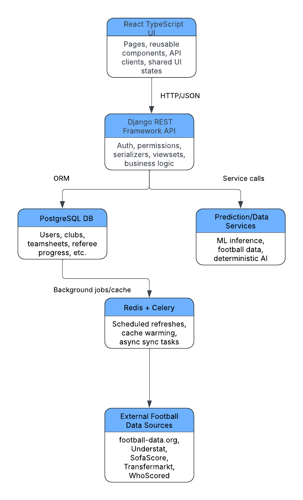

# xgGaffer: Football Analytics and Coaching Platform


**Project:** xgGaffer | **Module:** CSC1097 Final Year Project | **Institution:** Dublin City University
**Authors:** Ehis Oghina, Elizabeth Adeniran | **Supervisor:** Dr. Ellen Rushe | **Year:** 2025/2026

---

## Abstract

xgGaffer is a full-stack football analytics and coaching platform built to make advanced football insights accessible to a wide community. Coaches can manage clubs, players, formations and tactics. Fans and analysts can explore live football data and machine learning-powered match predictions. Referees can study the Laws of the Game through structured learning modules. The platform is built with Django REST Framework, React TypeScript, PostgreSQL, Redis/Celery, and Python ML services trained on historical football match data.

---

## Key Features

| Area                     | Features                                                                                                         |
| ------------------------ | ---------------------------------------------------------------------------------------------------------------- |
| **Authentication**       | Email verification, password reset, role selection (Coach / Player / Referee / Fan), httpOnly cookie/JWT auth    |
| **Club Management**      | Create clubs, manage squads and injuries, join codes, approval workflows, coaching resources, fixture scheduling |
| **Teamsheets & Tactics** | Visual formation builder (4-4-2, 4-3-3, 3-5-2 etc.), canvas tactics board with animation frames                  |
| **Live Football**        | League tables, fixtures, top scorers, xG/xGA/PPDA enriched stats, scenario simulation                            |
| **Predictions**          | Match outcome prediction, score engine, season projections, odds comparison, model trust centre                  |
| **Referee Learning**     | Laws of the Game courses, quizzes, scenario walkthroughs, progress tracking                                      |
| **Social**               | Post feed, nested comments, likes, hashtags, user follows, content moderation                                    |
| **Articles**             | Personalised football article recommendations with trust scoring and reading history                             |
| **Data Sync**            | Multi-provider sync pipeline (football-data.org, Understat, Sofascore, Transfermarkt) with health monitoring     |

---

## System Architecture



**Architecture principles:**

- Backend split across 15+ Django apps by domain (`clubs`, `predictions`, `livefootball`, `sync_pipeline`, `tactics`, etc.)
- Shared `common/` layer in both backend and frontend for reusable utilities, constants and response envelopes
- Multi-provider data layer with canonical identity resolution across external football sources
- Deterministic prediction explanations generated from known model outputs and templates, not free-form LLM responses

---

## Machine Learning Engines

The prediction layer comprises eight ML engines:

| Engine                    | Method                                         | Status   |
| ------------------------- | ---------------------------------------------- | -------- |
| 1 — Team Strength (Elo)   | Elo rating system                              | Complete |
| 2 — Match Outcome         | Logistic Regression + betting odds integration | Complete |
| 3 — Score Engine          | Poisson / Dixon-Coles                          | Complete |
| 4 — Season Simulation     | Monte Carlo                                    | Complete |
| 5 — Injury/Availability   | Cox PH + XGBoost (isotonic calibration)        | Complete |
| 6 — Micro-Action Tactical | XGBoost pass classifier + K-means clustering   | Complete |
| 7 — Lineup Prediction     | XGBoost                                        | Planned  |

The match outcome model achieved **~55.5% accuracy** on a three-class problem (home / draw / away), significantly above the 33% random baseline. Model artefacts are saved as `.joblib` files and served through prediction API endpoints.

> Large generated datasets and model artefacts may need to be regenerated separately — refer to the Technical Guide for instructions.

---

## Repository Structure

```text
project-root/
├── build/
│   ├── backend/
│   │   ├── apps/
│   │   │   ├── articles/          # Article feed and recommendations
│   │   │   ├── clubs/             # Club management and membership
│   │   │   ├── community/         # Posts, comments and social features
│   │   │   ├── laws/              # Referee learning modules
│   │   │   ├── livefootball/      # Competitions, standings, fixtures
│   │   │   ├── playerdata/        # Player/club enrichment (xG, xGA, PPDA)
│   │   │   ├── predictions/       # ML models and prediction APIs
│   │   │   ├── sync_pipeline/     # Provider sync and snapshot management
│   │   │   ├── tactics/           # Tactics board
│   │   │   ├── teamsheets/        # Formation and teamsheet builder
│   │   │   ├── training/          # Training session planner
│   │   │   └── users/             # Auth, profiles and roles
│   │   ├── common/                # Shared utilities, cache keys, constants
│   │   ├── services/              # Provider query and aggregation services
│   │   └── manage.py
│   └── web-frontend/
│       └── src/
│           ├── common/            # Shared frontend components
│           ├── components/        # Reusable feature components
│           ├── pages/             # Route-level pages (25+)
│           ├── services/          # API clients
│           └── types/             # TypeScript type definitions
├── docs/documentation/            # Technical Guide, User Manual, Testing Document
└── README.md
```

---

## Local Development Setup

### Prerequisites

- Python 3.10+, Node.js, PostgreSQL, Redis, Git

### Steps

```bash
git clone https://gitlab.computing.dcu.ie/adenire2/2026-csc1097-adenire-2-oghinae-2.git
cd 2026-csc1097-adenire-2-oghinae-2/build

# Backend
cd backend
python3 -m venv ../.venv
source ../.venv/bin/activate
pip install --upgrade pip
pip install -r requirements.txt
python3 manage.py migrate
python3 manage.py createsuperuser

# Frontend
cd ../web-frontend
npm install

# Redis (if not running locally)
docker run --name redis -p 6379:6379 -d redis:7
```

### Environment Variables

Create `build/backend/.env`:

| Variable                                      | Required       | Purpose                |
| --------------------------------------------- | -------------- | ---------------------- |
| `SECRET_KEY`                                  | Yes            | Django secret key      |
| `DEBUG`                                       | Yes            | Debug mode             |
| `POSTGRES_DB / USER / PASSWORD / HOST / PORT` | Yes            | PostgreSQL connection  |
| `REDIS_URL`                                   | Yes            | Redis for Celery/cache |
| `RESEND_API_KEY`                              | Email features | Transactional email    |
| `CLOUDINARY_URL`                              | Media uploads  | File storage           |
| `FOOTBALL_DATA_API_KEY`                       | Live sync      | football-data.org      |
| `ODDS_API_KEY`                                | Odds refresh   | Odds provider          |
| `ALLOWED_HOSTS` / `CSRF_TRUSTED_ORIGINS`      | Production     | Host and CSRF config   |

### Running the Application

````bash
# Backend — from build/backend
source ../.venv/bin/activate
python3 manage.py runserver           # http://localhost:8000

# Frontend — from build/web-frontend
npm run dev                           # http://localhost:5173

# Celery worker and beat — from build/backend
./start_workers.sh

---

## Testing & Deployment

### Testing

```bash
# Backend
source ../.venv/bin/activate
python3 manage.py test
python3 manage.py check

# Frontend
npm run test
npm run build
````

The testing strategy covers backend unit and API tests, frontend component tests, ML pipeline tests, and formal manual system tests. Full results are documented in the Testing Document.

### Deployment

A production environment requires PostgreSQL, Redis, Celery worker and beat, collected static files, model artefacts, HTTPS, `DEBUG=False`, and correct `ALLOWED_HOSTS`/CSRF settings.

```bash
python3 manage.py migrate
python3 manage.py collectstatic --noinput
python3 manage.py check --deploy
```

Detailed deployment steps are in the Technical Guide.

---

## Documentation

Final project documents are located in `docs/documentation/`:

| Document         | Purpose                                         |
| ---------------- | ----------------------------------------------- |
| Technical Guide  | Design, implementation, results and future work |
| User Manual      | Installation, user guide and screenshots        |
| Testing Document | Testing strategy, results and discussion        |

---

## Known Limitations

- External data features depend on third-party API availability and valid keys.
- Model artefacts and seeded football data may need to be regenerated — see Technical Guide.
- Prediction outputs are analytics support tools, not guaranteed results.
- Free-tier deployment environments may constrain background processing and memory.

---

## Contributors & Acknowledgements

**Developers:** Ehis Oghina, Elizabeth Adeniran
**Supervisor:** Dr. Ellen Rushe — Dublin City University, School of Computing

Built with Django, DRF, React, TypeScript, Vite, PostgreSQL, Redis, Celery, pandas, scikit-learn and XGBoost. Football data provided by football-data.org, Understat and Sofascore. Email delivery via Resend.

---
